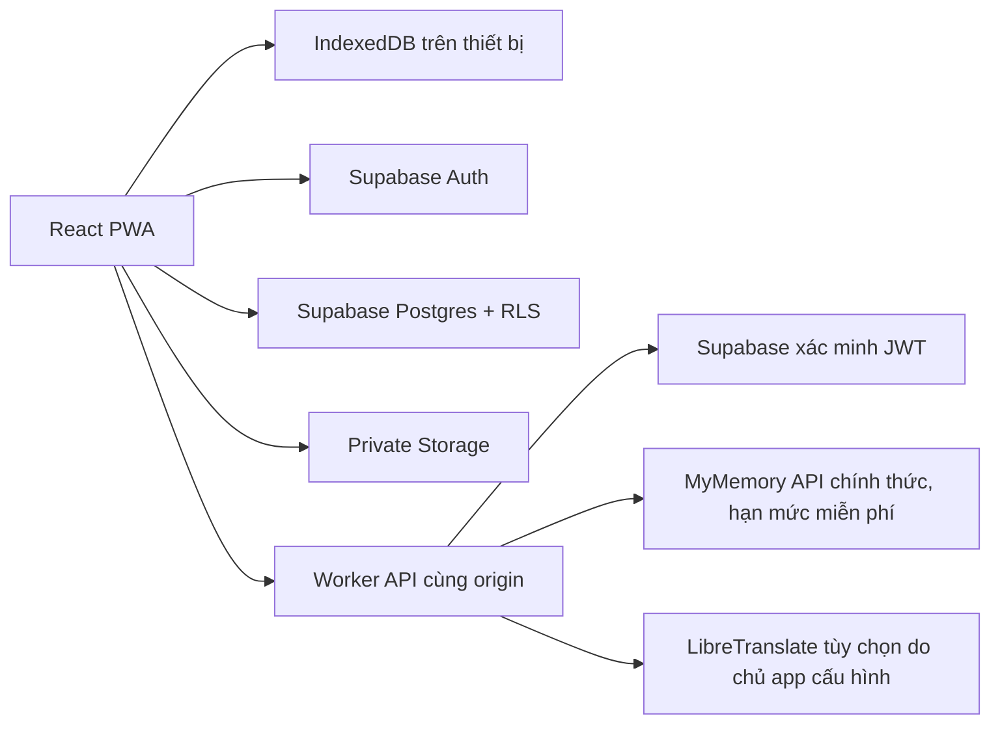

# Kiến trúc và dữ liệu

React + TypeScript/Vite, IndexedDB qua `idb`, Cloudflare Worker/Static Assets, Supabase Auth/Postgres/Storage. Không triển khai AI/ML nặng bên trong Workers. Không chạy OCR hay dịch toàn sách trong một HTTP request.

## Ranh giới mô-đun

- `model.ts`: ba ngôn ngữ, UUID đoạn, phiên bản/khóa bản dịch và gộp từ.
- `importer.ts`: giới hạn tệp/zip, băm nguyên bản, EPUB spine, trích xuất văn bản DOCX/HTML. HTML chỉ thành text, không đưa HTML nguồn vào DOM hiển thị.
- `store.ts`: cùng giao diện cho IndexedDB và Supabase. Không tự sao chép thư viện cục bộ lên tài khoản. Revision compare-and-swap cho nội dung sách cloud; hàng đợi vị trí đọc và cache theo UUID tài khoản.
- `App.tsx`: thư viện, trình đọc, CSV, tài khoản, phụ huynh và luyện đọc. Lỗi lưu luôn được hiển thị; không báo thành công trước khi thao tác lưu hoàn tất.
- `worker/index.ts`: cấu hình phía server, auth trước dịch, kiểm tra origin/ngôn ngữ/kích thước, không cho client chọn URL dịch vụ, không log văn bản/secret. Endpoint cấu hình không theo redirect. Không có URL-import tùy ý trong giai đoạn này, tránh đưa một proxy SSRF vào API.
- `sw.js`: chỉ cache shell và tài nguyên tĩnh cùng origin; dữ liệu local qua IndexedDB. Không cache API, token, tài liệu tài khoản.

## Mô hình đang triển khai

| Thực thể | Nơi lưu | Quan hệ/nội dung |
|---|---|---|
| Người lớn | Supabase `auth.users` | UUID định danh chủ dữ liệu |
| Book | `books.document` / IndexedDB `books` | Cloud chỉ giữ nội dung gốc và metadata; local giữ aggregate riêng |
| Chapter → Paragraph | Trong book JSONB | UUID ổn định; text nguyên bản và bản dịch không ghi đè nhau |
| Translation | Theo paragraph + ngôn ngữ đích | Text, provider, thời gian, khóa, tối đa 20 bản trước |
| Note/highlight/position | Cloud `reading_states` / book local | Mỗi tài khoản một hàng/sách; vị trí tự lưu khi cuộn/lật trang; chú thích và bản dịch riêng |
| Original file | Private Storage / IndexedDB `originals` | `<owner>/<book>/original`; không lấy filename người dùng làm đường dẫn |
| Vocabulary | `vocabulary.document` / IndexedDB settings | Term, nghĩa, ngôn ngữ, trạng thái; nhiều câu/ID sách/ID đoạn |
| Child | `children.document` / IndexedDB settings | Nickname, tuổi, mức đọc, ngôn ngữ; không login độc lập |
| Translation job | IndexedDB settings | Ghi trạng thái tiến độ trong tab; phục hồi từ các đoạn đã lưu |
| Recording | RAM Blob URL | Không upload hoặc lưu dài hạn, xóa khi thoát component |
| CSV result | IndexedDB settings | Kết quả nhập gần nhất, chỉ metadata |

`books.revision` tăng bằng trigger. Update dùng điều kiện revision đã đọc; kết quả 0 row là xung đột, không tự ghi đè. Cần tải lại để giải quyết. Thư viện cloud làm mới mỗi 10 giây khi tab hiện, khi focus hoặc có mạng trở lại; đây là polling, không phải Supabase Realtime.

Các bảng `translation_jobs` và `integration_events` đã có schema/RLS cho bước kế tiếp nhưng chưa nối worker nền. Không quảng bá các bảng này như tác vụ nền đã vận hành.

Book JSONB là aggregate giai đoạn 1: căn chỉnh và chỉnh sửa nguyên tử, giảm số request. Hạn chế: tải toàn bộ sách vào bộ nhớ và cập nhật aggregate. Sách dài/đồng bộ nhiều thiết bị cần migration tách `chapters`, `paragraphs`, `translations`, `translation_versions`, `reading_positions`, `annotations` ở giai đoạn 3; không hứa hiệu năng sách hàng trăm MB.

## Mô hình kế tiếp (chưa tạo bảng/chưa có tính năng)

- `book_sources`, `series`, `volumes`, `source_chapters`, `import_jobs`: nguồn chính thức, quyền sử dụng, tiến độ nhập.
- `glossaries`, `glossary_entries`, `translation_segments`, `translation_versions`, `provider_usage`: glossary, lease/idempotency, chi phí và phiên bản.
- `flashcards`, `review_events`: lịch SRS theo từ/nghĩa/ngữ cảnh.
- `reading_lessons`, `practice_sessions`, `practice_results`, `recordings`: hoạt động trẻ theo phụ huynh, consent/retention rõ ràng.
- `integration_configs`, `integration_events`: metadata tích hợp và nhật ký, không lưu secret API dạng thuần.

## Bảo mật

RLS không dựa vào owner ID client để cấp quyền; `auth.uid()` quyết định SELECT/INSERT/UPDATE/DELETE. FK cascade khi xóa auth user không tự xóa Storage; luồng xóa tài khoản hoàn chỉnh và thu gom tệp cần worker đặc quyền riêng, **chưa triển khai**. Hiện có xóa từng sách/tệp và xóa hồ sơ trẻ cùng danh sách phê duyệt.

Chế độ trẻ ẩn điều hướng người lớn và liên kết ngoài khi luyện đọc, chỉ lọc sách đã duyệt. Có PIN trên trình duyệt khi thoát hoặc tải lại phiên trẻ; đây không phải ranh giới xác thực riêng. Không có quảng cáo/mua hàng/nhận xét phát âm giả.

Bản sao lưu chứa dữ liệu riêng tư nhưng không chứa credential. Chế độ cục bộ chưa mã hóa tại thiết bị. Cache cloud và outbox tách theo UUID tài khoản; thư viện cục bộ vẫn dùng chung hồ sơ trình duyệt. Browser permission controls microphone; không tự kích hoạt ghi âm hoặc gửi dữ liệu giọng nói ra ngoài.

## PDF/OCR trên thiết bị

`pdf.ts` tải PDF.js qua lazy chunk và dùng PDF worker cùng origin. Trích lớp chữ từng trang; OCR với Tesseract worker chỉ khi cần hoặc theo lựa chọn người dùng. Canvas raster giới hạn cạnh dài 2200px và thả sau từng trang. Không thực thi JavaScript/annotation action của PDF. CSP cho phép WebAssembly qua `wasm-unsafe-eval` và worker cùng origin, không thêm `unsafe-eval` chung hoặc CDN.

OCR models và runtime được chuẩn bị từ lockfile vào `public/ocr`; PDF fonts/cmaps/WASM ở `public/pdf`. Chỉ runtime từng dùng được cache; file tài liệu người dùng không vào HTTP cache. PDF gốc ở IndexedDB/private Storage; chương JSON có `sourcePage` và `ocr`, dữ liệu cũ không cần chuyển đổi. OCR text được kiểm tra/sửa trước khi lưu, giữ SHA-256 của PDF nguyên bản. Cùng tệp/ngôn ngữ/khoảng trang bị chặn trùng; các khoảng khác nhau được nhập riêng.

Hủy dùng AbortController cho tải model, hủy PDF loading task và chấm dứt OCR worker; nếu hủy khi worker còn khởi tạo thì worker được chấm dứt ngay khi khởi tạo xong. Không có OCR nền khi đóng tab. Checkpoint từng trang lưu ở IndexedDB pdfDrafts (DB version 2), khóa bằng SHA-256 + ngôn ngữ + mode; mặc định toàn bộ PDF. Các trang đã xong được bỏ qua khi tiếp tục; không upload checkpoint cloud.

## Phân trang và nguồn metadata

`reading.ts` chia phần hiển thị theo ngân sách ký tự, giữ ID gốc và khoảng start/end; không sửa source hoặc bản dịch. Bản dịch đoạn dài chia theo tỷ lệ độ dài ở ranh giới từ, nên không cam kết căn từng câu giữa ngôn ngữ; cuộn liên tục giữ cặp đoạn đầy đủ. `Book.position.offset` là tùy chọn tương thích bản sao lưu cũ. Dải chương đang tải tăng khi IntersectionObserver thấy sentinel.

DTV adapter chỉ cho HTTPS của hai hostname cố định, kiểm tra lại mỗi redirect, giới hạn HTML 1,5 MB/tệp 50 MB. Chỉ gửi request user chọn, không chuyển cookie/credential. Danh mục là tiêu đề/link, không phải nội dung toàn văn. Có site-search mở trong browser để sử dụng khi nguồn chặn server fetch. `mymemory.ts` chỉ gọi endpoint get chính thức, không gọi API đóng góp set, không nhúng khóa hay tự đổi nhà cung cấp; mỗi đoạn được chia an toàn UTF-8 và không lưu thông báo quota thành nội dung.

## Đồng bộ và nhóm đọc

Migration `202610210003_groups_and_progress.sql` tách trạng thái cá nhân khỏi sách chung, giữ lại dữ liệu cũ trước khi làm sạch nội dung canonical. `bookState.ts` tách/ghép annotations, translations và danh sách trẻ. Đọc sách nhóm không cho phép sửa nội dung gốc; chủ sách giữ quyền sửa/xóa. Xóa sách gốc cũng xóa liên kết nhóm; UI xác nhận trước khi xóa.

`reading_groups` + `group_members` xác định quyền; mã mời có hạn 7 ngày/50 lượt, chỉ chủ nhóm tạo/thu hồi. RPC kiểm tra quyền phía server, RLS bảo vệ bảng và Storage. Unique(group, hash, language) chọn một book ID canonical; client tìm bản đã có trước khi upload, xử lý race và dọn bản mới bị trùng. Không gom/xóa ngầm các bản riêng đã tồn tại giữa những tài khoản khác nhau. File hash khác dù cùng tựa sách vẫn là hai tệp khác.

`reading_states(owner_id, book_id)` chứa vị trí theo chapter/paragraph/offset, ghi chú, highlight, bản dịch, kệ và phê duyệt trẻ. RPC vị trí chỉ cập nhật vị trí, RPC chú thích không ghi đè vị trí; timestamp bỏ cập nhật offline cũ. RPC tag nhóm chỉ trả nickname và ba tọa độ đọc, không trả chú thích/bản dịch. Nội dung sách và tệp gốc có thể đọc bởi thành viên; dữ liệu cá nhân chỉ chủ tài khoản đọc.

Vị trí tự lưu sau cuộn dừng khoảng 650 ms, khi lật trang và khi tab ẩn; localStorage lưu nhanh tọa độ cuối, IndexedDB giữ outbox cloud. Gửi lại khi có mạng/focus và mỗi 10 giây. Đọc cache cloud offline được hỗ trợ cho sách đã tải; chỉnh sửa chú thích/import cloud vẫn cần mạng, không có hàng đợi offline cho mọi loại chỉnh sửa. Bộ nhớ trình duyệt vẫn có thể bị hệ điều hành thu hồi. Đồng thời đọc trên hai thiết bị: cập nhật vị trí mới hơn thắng; chưa có merge chú thích đồng thời từng trường.

Tệp upload mới đặt cache-control 0. Thu hồi quyền chặn truy vấn DB/yêu cầu Storage mới; không thể thu hồi bản đã được tải xuống hoặc đã nằm trong cache bên ngoài. Cache cloud riêng của người dùng không phải cơ chế chống sao chép.

`useReadingProgress.ts` khôi phục tọa độ chữ; màn hình và ngân sách ký tự có thể tạo số trang khác nhau trên hai thiết bị. Tùy chọn trình đọc nằm trên từng thiết bị. `ReaderDock` mở bảng ngay trong trình đọc; `WordPopover` phân đoạn từ bằng Intl.Segmenter và dịch đúng từ được hover 500 ms/chạm, cache 30 ngày. Không tự dịch trang/chương. Google Dịch là liên kết web chính thức theo từ; chưa cấu hình Google Cloud Translation API/key. MyMemory vẫn có hạn mức; kết quả từ đơn không đảm bảo đầy đủ nghĩa theo ngữ cảnh.
