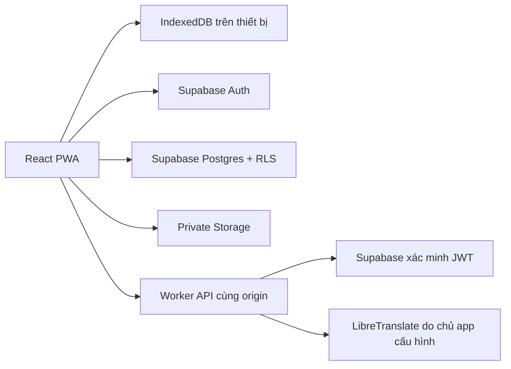

# Kiến trúc và dữ liệu

React + TypeScript/Vite, IndexedDB qua `idb`, Cloudflare Worker/Static Assets, Supabase Auth/Postgres/Storage. Không triển khai AI/ML nặng bên trong Workers. Không chạy OCR hay dịch toàn sách trong một HTTP request.

## Ranh giới mô-đun

- `model.ts`: ba ngôn ngữ, UUID đoạn, phiên bản/khóa bản dịch và gộp từ.
- `importer.ts`: giới hạn tệp/zip, băm nguyên bản, EPUB spine, trích xuất văn bản DOCX/HTML. HTML chỉ thành text, không đưa HTML nguồn vào DOM hiển thị.
- `store.ts`: cùng giao diện cho IndexedDB và Supabase. Không tự sao chép thư viện cục bộ lên tài khoản. Revision compare-and-swap cho cập nhật sách cloud.
- `App.tsx`: thư viện, trình đọc, CSV, tài khoản, phụ huynh và luyện đọc. Lỗi lưu luôn được hiển thị; không báo thành công trước khi thao tác lưu hoàn tất.
- `worker/index.ts`: cấu hình phía server, auth trước dịch, kiểm tra origin/ngôn ngữ/kích thước, không cho client chọn URL dịch vụ, không log văn bản/secret. Endpoint cấu hình không theo redirect. Không có URL-import tùy ý trong giai đoạn này, tránh đưa một proxy SSRF vào API.
- `sw.js`: chỉ cache shell và tài nguyên tĩnh cùng origin; dữ liệu local qua IndexedDB. Không cache API, token, tài liệu tài khoản.

## Mô hình đang triển khai

| Thực thể | Nơi lưu | Quan hệ/nội dung |
|---|---|---|
| Người lớn | Supabase `auth.users` | UUID định danh chủ dữ liệu |
| Book | `books.document` / IndexedDB `books` | Ngôn ngữ gốc, hash, metadata, kệ, vị trí, danh sách trẻ được duyệt |
| Chapter → Paragraph | Trong book JSONB | UUID ổn định; text nguyên bản và bản dịch không ghi đè nhau |
| Translation | Theo paragraph + ngôn ngữ đích | Text, provider, thời gian, khóa, tối đa 20 bản trước |
| Note/highlight/position | Trong book | Theo ID đoạn; vị trí lưu khi người dùng bấm đánh dấu |
| Original file | Private Storage / IndexedDB `originals` | `<owner>/<book>/original`; không lấy filename người dùng làm đường dẫn |
| Vocabulary | `vocabulary.document` / IndexedDB settings | Term, nghĩa, ngôn ngữ, trạng thái; nhiều câu/ID sách/ID đoạn |
| Child | `children.document` / IndexedDB settings | Nickname, tuổi, mức đọc, ngôn ngữ; không login độc lập |
| Translation job | IndexedDB settings | Ghi trạng thái tiến độ trong tab; phục hồi từ các đoạn đã lưu |
| Recording | RAM Blob URL | Không upload hoặc lưu dài hạn, xóa khi thoát component |
| CSV result | IndexedDB settings | Kết quả nhập gần nhất, chỉ metadata |

`books.revision` tăng bằng trigger. Update dùng điều kiện revision đã đọc; kết quả 0 row là xung đột, không tự ghi đè. Cần tải lại để giải quyết. Đây chưa phải realtime sync.

Các bảng `translation_jobs` và `integration_events` đã có schema/RLS cho bước kế tiếp nhưng chưa nối worker nền. Không quảng bá các bảng này như tác vụ nền đã vận hành.

Book JSONB là aggregate giai đoạn 1: căn chỉnh và chỉnh sửa nguyên tử, giảm số request. Hạn chế: tải toàn bộ sách vào bộ nhớ và cập nhật aggregate. Sách dài/đồng bộ nhiều thiết bị cần migration tách `chapters`, `paragraphs`, `translations`, `translation_versions`, `reading_positions`, `annotations` ở giai đoạn 3; không hứa hiệu năng sách hàng trăm MB.

## Mô hình kế tiếp (chưa tạo bảng/chưa có tính năng)

- `book_sources`, `series`, `volumes`, `source_chapters`, `import_jobs`: nguồn chính thức, quyền sử dụng, tiến độ nhập.
- `glossaries`, `glossary_entries`, `translation_segments`, `translation_versions`, `provider_usage`: glossary, lease/idempotency, chi phí và phiên bản.
- `flashcards`, `review_events`: lịch SRS theo từ/nghĩa/ngữ cảnh.
- `reading_lessons`, `practice_sessions`, `practice_results`, `recordings`: hoạt động trẻ theo phụ huynh, consent/retention rõ ràng.
- `integration_configs`, `integration_events`: metadata tích hợp và nhật ký, không lưu secret API dạng thuần.

## Bảo mật

RLS không dựa vào owner ID client để cấp quyền; `auth.uid()` quyết định SELECT/INSERT/UPDATE/DELETE. FK cascade khi xóa auth user không tự xóa Storage; luồng xóa tài khoản hoàn chỉnh và thu gom tệp cần worker đặc quyền riêng, **chưa triển khai**. Hiện có xóa từng sách/tệp và xóa hồ sơ trẻ cùng danh sách phê duyệt.

Chế độ trẻ ẩn điều hướng người lớn và liên kết ngoài khi luyện đọc, chỉ lọc sách đã duyệt. Có PIN trên trình duyệt khi thoát hoặc tải lại phiên trẻ; đây không phải ranh giới xác thực riêng. Không có quảng cáo/mua hàng/nhận xét phát âm giả.

Bản sao lưu chứa dữ liệu riêng tư nhưng không chứa credential. Chế độ cục bộ chưa mã hóa tại thiết bị. Chưa có multi-account local profile: dùng Supabase khi cần cách ly tài khoản. Browser permission controls microphone; không tự kích hoạt ghi âm hoặc gửi dữ liệu giọng nói ra ngoài.

## PDF/OCR trên thiết bị

`pdf.ts` tải PDF.js qua lazy chunk và dùng PDF worker cùng origin. Trích lớp chữ từng trang; OCR với Tesseract worker chỉ khi cần hoặc theo lựa chọn người dùng. Canvas raster giới hạn cạnh dài 2200px và thả sau từng trang. Không thực thi JavaScript/annotation action của PDF. CSP cho phép WebAssembly qua `wasm-unsafe-eval` và worker cùng origin, không thêm `unsafe-eval` chung hoặc CDN.

OCR models và runtime được chuẩn bị từ lockfile vào `public/ocr`; PDF fonts/cmaps/WASM ở `public/pdf`. Chỉ runtime từng dùng được cache; file tài liệu người dùng không vào HTTP cache. PDF gốc ở IndexedDB/private Storage; chương JSON có `sourcePage` và `ocr`, dữ liệu cũ không cần chuyển đổi. OCR text được kiểm tra/sửa trước khi lưu, giữ SHA-256 của PDF nguyên bản. Cùng tệp/ngôn ngữ/khoảng trang bị chặn trùng; các khoảng khác nhau được nhập riêng.

Hủy dùng AbortController cho tải model, hủy PDF loading task và chấm dứt OCR worker; nếu hủy khi worker còn khởi tạo thì worker được chấm dứt ngay khi khởi tạo xong. Không có OCR nền sau đóng tab hoặc checkpoint bền vững.
